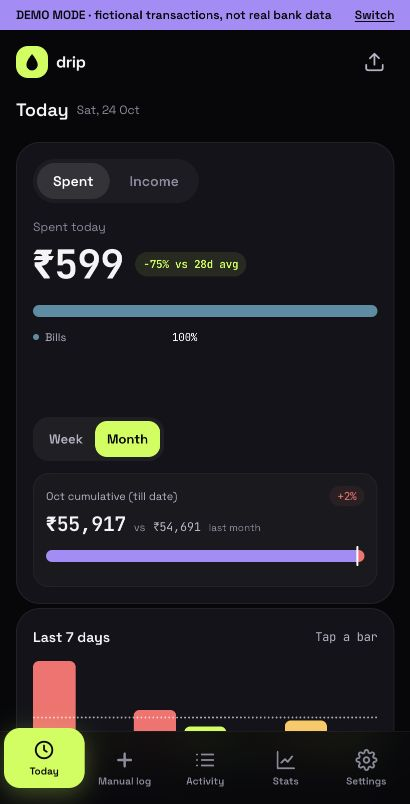
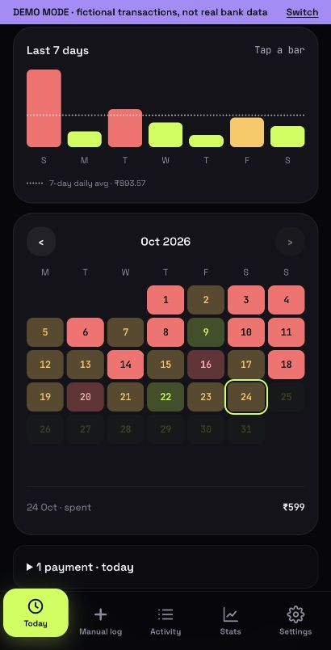
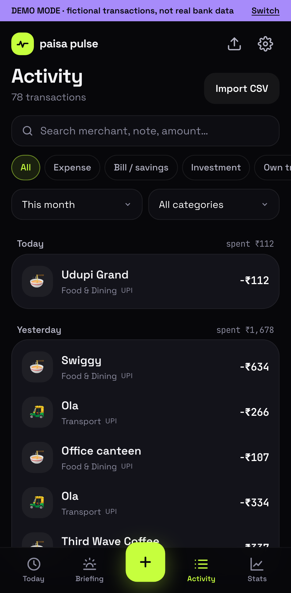
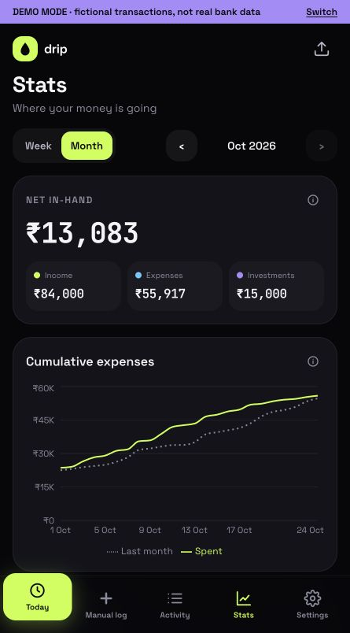
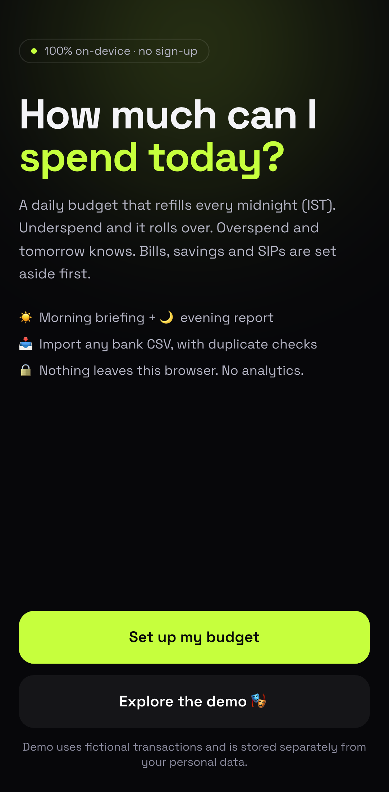

# drip

*Your money, one day at a time.*

**"How much can I spend today, and where is my money going?"**: a mobile-first, on-device daily budget for India. (Formerly Paisa Pulse: the APK file, GitHub repo and internal storage names still use the old name; see [Modes and privacy](#modes-and-privacy).)

Bills and savings are set aside first; the rest becomes a daily allowance that refills at midnight IST. Underspend and it rolls over. Overspend and it becomes a deficit that later days pay back. On Android, your bank's transaction SMS are read automatically, on the phone, so spending shows up without typing anything.

<p>
  
  
  
  
  
</p>

<sub>Screenshots use the built-in demo mode: fictional transactions, not real bank data.</sub>

## Install on Android

Latest installed phone build: **0.8.11 (23)**, installed over the existing app on 24 Oct 2026 with data retained; Android package version verified.


Scan the QR (or open [the latest release](https://github.com/rohan9405/paisa-pulse/releases/latest)) to download `PaisaPulse.apk`. Android 8 or newer.

**Heads-up: Play Protect blocks this install from a browser.** Google's enhanced fraud protection (live in India) refuses any app installed from a browser, chat or file manager that asks to read SMS, and there is no "Install anyway". Use one of these instead:

**A. Install from a computer over Wi-Fi (keeps Play Protect on)**
1. On the phone: Settings → About phone → tap **Build number** 7 times to enable Developer options.
2. Developer options → **Wireless debugging** → on. Phone and computer on the same Wi-Fi.
3. Tap **Pair device with pairing code**, then on the computer (with [platform-tools](https://developer.android.com/tools/releases/platform-tools)):
   ```bash
   adb pair <ip>:<pairing-port> <code>
   ```
4. Connect using the IP & port on the main Wireless debugging screen (a different port), then install:
   ```bash
   adb connect <ip>:<port>
   ```
   ```bash
   adb install -r PaisaPulse.apk
   ```
5. Turn Wireless debugging off again. The app doesn't need it. A USB cable with USB debugging works the same way.

> macOS: if `adb pair` fails with `protocol fault` while the phone is reachable, the running adb server may lack Local Network permission. Start a fresh one on another port, e.g. `adb -P 5038 pair …`, and use `-P 5038` for the following commands.

**B. Pause Play Protect briefly**: Play Store → profile → Play Protect → ⚙️ → turn off *Scan apps with Play Protect*, install the downloaded APK, then turn it straight back on.

**First run**
1. SMS access is optional. After budget setup, tap **Set up SMS import**, read the disclosure and choose **Agree and continue** before Android asks for permission. Manual entries and CSV import work without SMS access.
2. **Set up my budget**: choose tracking, planned set-aside (income and planned amounts), or actual set-aside (no budget amounts; uses recorded income/payments), then the **tracking start date**. Bank SMS from that date onwards are imported.
3. Need older history later? Settings → Tracking → move **Tracking start** earlier and save; the app reads your SMS back to that date.

### Your data across updates

- **Updates keep everything**: transactions, tags/rules, settings and the SMS read position. App data stays on the phone across updates. The build refuses any APK that couldn't install over the existing app (wrong signing key or a lower version), so you never have to uninstall to update.
- **Turn on automatic backup** (Settings → Your data → *Choose backup folder*, e.g. a new "drip" folder in Documents, or Google Drive). A full backup is written there every day (last 14 kept). It lives outside the app, so it survives uninstalling or *Clear data*.
- **New phone or reinstall:** on the welcome screen tap **Have a backup? Restore it** and pick the latest file. After a reinstall, choose the backup folder again in Settings.

## How bank SMS import works

- Only messages from known bank sender IDs (HDFC, ICICI, SBI, Axis, Kotak, e.g. `VM-HDFCBK-S`) are considered. Texts from phone numbers are dropped on the device before the app sees them.
- OTPs, offers, statements, due-date reminders, payment requests and failed/declined transactions are ignored.
- Amount, direction, account, payee/merchant (with the payee's UPI ID where shown), UPI/bank reference and payment method are read from the body, then categorised with the same rules as CSV import; merchant names are cleaned ("BUNDL TECHNOLOGIES" → Swiggy). Credit-card bill payments are treated as transfers so card spends aren't counted twice; refunds are linked to the original purchase; UPI Lite top-ups count as everyday spend.
- Autopay / e-mandate SMS (created, changed, cancelled) become recurring payments. "Avl bal" / "Avl limit" give account balances (can be switched off).
- Sync runs when the app opens, when it comes back to the foreground and every minute while open. Messages are de-duplicated by fingerprint and bank reference.
- Everything stays on the phone: SMS are parsed in the app and stored in its local IndexedDB.

Parser: [src/lib/sms.ts](src/lib/sms.ts) · sync: [src/data/providers/sms.ts](src/data/providers/sms.ts) · native shell: [android/](android/).

## Run it

```bash
npm install
```

```bash
npm run dev        # http://localhost:3100
```

```bash
npm test           # unit tests (budget math, CSV, SMS parsing + sync, matching, demo data)
```

```bash
npx playwright install chromium && npm run test:e2e   # E2E on Pixel 7 + desktop Chrome
```

Production web build: `npm run build && npm start`.

### Google Play preparation

See [docs/PLAY_STORE.md](docs/PLAY_STORE.md) for signed App Bundle builds, versioning, store assets, permission declarations, and the remaining account/testing gates. `npm run android:bundle` generates `android/build/drip.aab` alongside the update-compatible APK. The public [privacy policy](https://rohan-tripathi-product.vercel.app/drip-privacy.html) is also bundled offline and linked from welcome and Settings.

### Build the Android app

```bash
python3 android/build.py   # → android/build/PaisaPulse.apk
```

No Gradle: the script builds a static export of the web app (`NEXT_STATIC_EXPORT=1`), then calls the Android SDK tools directly (aapt2, javac, d8, zipalign, apksigner). Point it at your SDK and JDK with `ANDROID_BUILD_TOOLS` (a `build-tools/35.0.0` folder), `ANDROID_JAR` (`platforms/android-35/android.jar`) and `JAVA_HOME` (JDK 17+), or put the three paths in a git-ignored `android/local.json` (`build_tools`, `platform`, `java`).

The shell (`android/src`) is a WebView that serves the export from the APK on a private `https://paisapulse.local` origin (never change it: the app's storage belongs to that origin), exposes the SMS inbox as `window.PaisaSms` (read-only) and file saving / the backup folder as `window.PaisaFiles`.

Update safety, enforced by `build.py`:
- The APK must be signed by the certificate pinned in `android/signing-cert.sha256`. If the keystore is missing the build stops rather than making a new key. Only the very first build uses `--new-key`.
- **Secrets never live in the repo.** The APK keystore, the config signing key and the admin password are kept in `~/.drip-private/` on the developer's machine (override with `DRIP_PRIVATE_DIR`), outside the working tree, so they can't be committed even by accident. Back that folder up somewhere offline.
- `package.json` is the version source: `version` and `androidVersionCode`. Run `npm run release:bump -- patch` (or `minor` / `major`) for each new release; the build injects both into Android and rejects downgrades.
- Database changes must add a new Dexie `version()` with an upgrade step and never drop data; `tests/unit/backup.test.ts` fails if a table is missing from the backup.

To serve the APK on your LAN with a QR code: `python3 android/install.py`. Note that Play Protect still blocks browser installs (see above).

Regenerate the screenshots after a build: `node scripts/screenshots.mjs`.

## Stack

Next.js 15 (App Router) · TypeScript · Tailwind CSS · Recharts · Dexie (IndexedDB) · Vitest · Playwright · Android WebView (Java, no third-party libraries).

```
src/lib/            pure financial logic: no React, no storage
  money.ts          integer paise, Indian formatting, safe amount parsing
  dates.ts          Asia/Kolkata DateKeys, month/leap-year arithmetic
  budget.ts         pool, budget modes, daily allocation + rounding, ledger, set-asides, outgoings
  csv.ts            parse → map → validate → dedupe
  sms.ts            bank sender IDs, SMS → transaction parsing and classification, mandates, balances
  categorize.ts     category + tag rules (by payee UPI ID or text), narration → merchant, payment method
  merchants.ts      clean merchant names (legal names → brands)
  match.ts          refund ↔ expense, payment ↔ reservation, transfer pairs
  recurring.ts      upcoming bills and autopays for "Coming up"
  overview.ts       month pace and projection, week bars, calendar, weekly insight
  insights.ts       morning brief, night report, streaks/levels/badges
src/data/           storage + adapters
  db.ts             Dexie schema; separate DBs for demo and personal
  migrate.ts        in-place data migrations (also applied to old backups on restore)
  repo.ts           all writes (add/edit/delete, import, backup, rules)
  backup.ts         automatic daily backup to a user-picked folder (Android)
  device.ts         haptics and fingerprint lock (Android)
  providers/        provider interface, registry, demo generator, SMS sync
src/app/            screens (Today, Briefing, Activity, Stats, Import, Settings, Onboarding)
android/            WebView shell, SMS / files / device bridges, build + LAN install scripts
tests/unit, tests/e2e
docs/               budget rules, data integration, roadmap, marketing
```

## Screens

Category amounts are always visible alongside percentages. Hold and drag across trend bars to inspect values or across calendar dates to select a day; taps and keyboard controls also work.

Category colours are permanent and shared across Today and Stats. They use a muted palette separate from status and comparison charts; category dots, labels and percentages align on one row.

Today compares the selected day with the previous 28 completed days (including zero-spend days). The rolling trend covers the selected day and six days before it; its dotted line is their daily average. Incomplete reference windows show no comparison rather than inventing an average. Week/month cumulative comparisons still use equal calendar periods. Previous/next arrows inspect seven-day windows without changing the daily snapshot; the right arrow can advance from an older calendar selection through today. Stats ends with a month-labelled twelve-month spending heatmap: darker shades mean higher spending, and tapping a day shows its amount.

| Screen | What it does |
|---|---|
| Onboarding | Budget mode (set-aside, planned or actual, or "just track"), income, bills / investments / savings with due days and "already paid this month", tracking start date, opening adjustment (default ₹0), live pool preview incl. shortfall warning |
| Today | Unified spending/income view: selected-day breakdown, week and month cumulative with equal-period comparisons, a rolling 28-day average badge, Week/Month comparison tabs (Month default), always-visible category values, one category pattern, scrubbable rolling seven-day bars with weekday/date labels, previous/next ranges through today and a seven-day average line, fixed calendar, daily transactions, upcoming payments and current balances. |
| Briefing (legacy link) | Opens the unified Today view; no separate tab or morning/night report. Historical links retain their selected day. |
| Activity | Search, kind/category/period filters, edit, delete, category correction (optionally saved as a rule), match to bill/savings reservation, link refunds, smart suggestions for bill matches and own-account transfers |
| Stats | Tap a category to open that month’s filtered Activity. Week/month: Net In-Hand (income − expenses − investments), three summary cards, cumulative spend vs budget, daily spending chart with the month’s daily-average dotted line, category breakdown and planned payments; neon-green twelve-month spending heatmap below Expenses by category (darker means more spending) |
| Import CSV | Column mapping, date-format choice, three amount layouts, preview with per-row errors, duplicate detection, per-row include/exclude, undo import |
| Settings | Budget · Data · App tabs. Budget: mode, changes effective from a date (history preserved), recurring payments. Data: tracking start (moving it earlier backfills SMS) / opening adjustment, category + tag rules, balances switch, backup folder, JSON/CSV export, restore, typed-confirmation delete, mode switch. App: fingerprint lock, haptics |

## Modes and privacy

- **Demo mode** is labelled on every screen and uses deterministic, fictional Indian transactions tagged `providerId: "demo"`. It lives in its own IndexedDB database (`paisa-pulse-demo`) and never reads SMS.
- **Personal mode** (`paisa-pulse-personal`) holds manual entries, CSV imports and, in the Android app, bank SMS.
- No analytics, no external AI calls, no accounts. Fonts are self-hosted at build time.
- **Internet is download-only:** the Android app fetches one settings file (tabs, text, categorisation rules, feature switches) from the [config backend](backend/README.md) and blocks every other outside address. Nothing about you or your transactions is ever sent; offline, it uses the last copy.
- **Turn on automatic backup in the Android app.** In a browser, data lives only in that browser: export from Settings.
- The app never asks for bank passwords, PINs or OTPs.
- **Old name inside, on purpose.** The app was renamed from Paisa Pulse to drip, but the Android package (`dev.paisapulse.app`), the WebView origin (`paisapulse.local`), the database names, storage keys and the backup format / file prefix (`paisa-pulse-backup-`) keep the old name. Changing any of them would orphan existing data or backups. The APK file is still `PaisaPulse.apk` because the install QR and release link point to it.

## Not implemented yet

- **Scheduled notifications.** Not yet implemented; Today combines the former briefing content.
- **General background SMS sync without a widget.** Foreground imports run while the app is open. With a home-screen widget installed and SMS consent granted, a short on-device job can also import supported bank alerts while the app is closed; Android may delay it.
- **Account Aggregator bank sync.** See [docs/DATA_INTEGRATION.md](docs/DATA_INTEGRATION.md) for what an AA integration requires.
- iPhone SMS import (iOS doesn't let apps read SMS), multi-currency, split expenses, multiple budgets.

## Docs

- [docs/HOME_WIDGET.md](docs/HOME_WIDGET.md): the Android 4 × 2 home widget, installation, refresh behaviour and privacy.

- [docs/BUDGET_LOGIC.md](docs/BUDGET_LOGIC.md): the exact budget rules.
- [docs/ROADMAP.md](docs/ROADMAP.md): what's built, what's next, and decisions, including friends (Phase 5) and offline engagement like "You skipped it" (Phase 6), with what to avoid.
- [docs/MARKETING.md](docs/MARKETING.md): the name, icon, voice, copy ideas and store listing draft.
- [docs/DATA_INTEGRATION.md](docs/DATA_INTEGRATION.md): bank data options in India (SMS, CSV, Account Aggregator).

### Tagging by recipient

In Activity, switch to **Recipients** to apply a category and tag to matching payments for one recipient within the last 12 months. Bulk edits use the date index to skip older history, and only write payments whose category or tag needs to change. Matching uses the UPI ID when present, otherwise an exact name (ignoring case and extra spaces). Incoming and outgoing payments are grouped separately; refunds and own transfers stay in the transaction editor.

When editing a transaction, drip offers to apply the same category and tag to matching payments in the last 12 months, checked by default. Older payments stay unchanged by bulk edits; they can still be edited individually. **Remember for future payments** is checked by default and saves the choice for new SMS, CSV, and manual transactions. Uncheck it for one-off exceptions. Remembering by itself does not rewrite past payments.

Recipients defaults to **Needs tagging**. Consistently categorized recipients move to **Archived**, where they remain editable. A category is sufficient; finer tags are optional. New untagged or inconsistent payments bring the recipient back into the queue. Archive status checks only the last 12 months, so older untouched history cannot keep a recipient pending.

### Tracking, IPOs and remote changes (0.8.1)

Tracking mode reports actual expenses including bills, with investments/savings shown separately and no daily allowance. IPO/ASBA blocks are separate records: block/release messages never count as spending or income; confirmed allotment debits count as Investments · IPO. Open blocks appear on Today; Activity retains their history. Incomplete confirmations stay flagged.

Remote navigation now offers five actions (Today, Manual log, Activity, Stats, Settings); legacy Brief IDs open Today. It supports and a configurable highlighted primary action. Remote categorisation changes affect future imports by default. A per-rule history checkbox explicitly allows updating untouched matching transactions within twelve months; user edits and personal rules always win. Neither a presentation change nor a parser version change triggers an automatic inbox reread. Empty SMS polls avoid transaction/rule scans and database writes.

Mandate reminders require a confirmed repeating frequency. Old guessed schedules are retained as unconfirmed; confirm frequency/due day in Settings. IPO and one-time mandates do not recur monthly. Backups include IPO holds and completed history-job receipts.

### Settlements and Stats accounting

Income includes every income bucket, excluding refunds and settlements. Link a Settlement to the expense you paid for a group; multiple people’s shares reduce that expense just like linked refunds, capped at the original amount. Unlinked settlements stay marked for review and never inflate income. Investments are separate from expenses. Savings is removed from new category choices; existing Savings data and rules remain intact and appear under Investments.

The daily spending chart’s dotted line is the selected month’s daily average through the selected period’s end (through today for the current period), counting tracked zero days.

### Navigation update · 0.8.10

Stats category rows open Activity with that category and the selected month prefilled, including older months. Activity’s period and category controls remain editable. The Today trend keeps its date range centered between arrows. Latest is removed; the next arrow can advance from older calendar selections up to today.

Calendar months show only the weeks containing dates, removing the unused bottom row. Sliding across Today dates/bars and Stats chart dates gives a light haptic tick per new selection on Android, respecting the app’s Haptic feedback setting and phone settings.

On Today, vertical swipes over the calendar and trend scroll the page; horizontal drags inspect dates/bars. Touch selection waits for a tap or horizontal intent so starting a page scroll does not change the selected date.

### Budget choices and IPO authorizations · 0.8.12

Remote config `budget.setAsideModes` offers Planned and Actual, Planned only, or Actual only. With one available mode, onboarding and the budget editor show its explanation and inputs without a mode selector. Publishing this setting does not change saved budgets or reread SMS.

Stats overlays last month’s cumulative spending as a dotted grey line, aligned to matching day numbers; incomplete previous-month history is left blank. IPO blocks/releases remain separate from spending. In Settings, mark an ambiguous autopay as IPO to exclude it from recurring totals/reminders; this preserves the mandate and does not fabricate a block, debit or release. Confirmed hold references can also identify older mandates; an explicit user classification wins.
